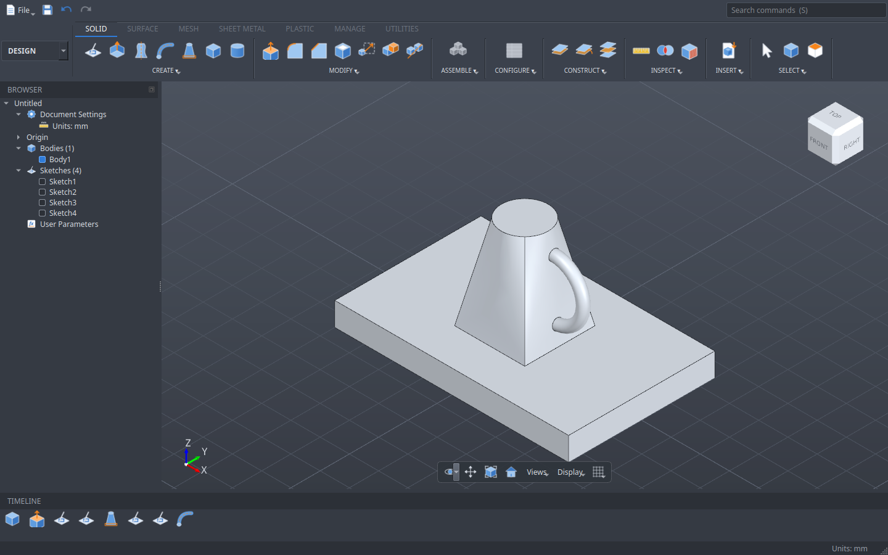
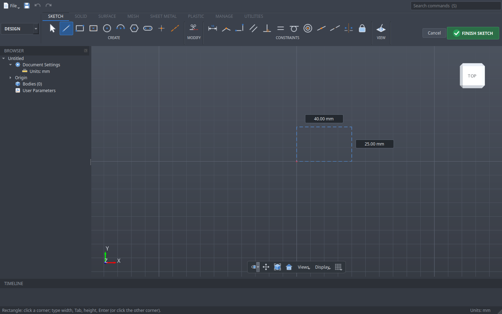
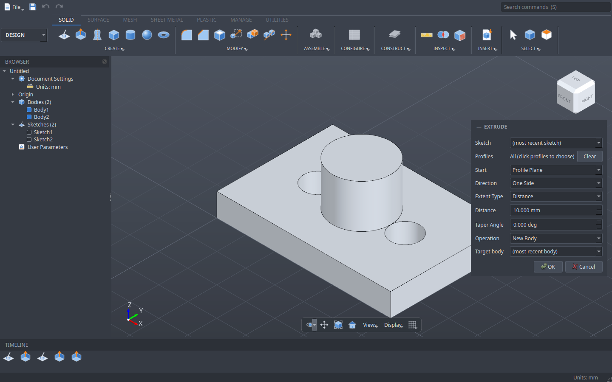

<h1 align="center">Tessera</h1>

<p align="center"><b>Parametric 3D CAD for Linux, built to feel like Fusion.</b><br>
Native on KDE / Kubuntu · fully offline · no accounts · no cloud · free software (GPL-3.0)</p>

<p align="center"></p>

Tessera is a desktop CAD application for designing parts: sketch, constrain, extrude, fillet, and change any
dimension later while the whole model updates. The layout, tools, shortcuts and workflow follow Fusion closely, so
people who know Fusion can work in Tessera straight away. Everything runs locally: there is no login, no cloud
storage, no telemetry, and nothing needs the internet once it is installed. Electronics / PCB design is out of
scope.

> **Status: alpha (0.1).** The core modelling workflow works and is tested; many tools are still to come (see
> [Planned](#planned)). Save often and keep backups of important designs.

## Contents

- [Features](#features) · [Install](#install) · [Using Tessera](#using-tessera) · [Planned](#planned)
- [Project layout](#project-layout) · [Development](#development) · [License](#license)

## Features

| Area | What you get |
|---|---|
| **Interface** | Ribbon in the familiar order (CREATE · MODIFY · ASSEMBLE · CONFIGURE · CONSTRUCT · INSPECT · INSERT · SELECT), browser, timeline, ViewCube, navigation bar, command panels inside the canvas, right-click marking menu, window (left to right) and crossing (right to left) selection boxes, a click picks the face or edge under the cursor (the edge wins near it), pre-selection (click a profile, face or edge, then start the command), rename in the Browser (click twice or F2) and timeline, **Space** repeats the last command, value boxes suggest parameter names, dark and light themes |
| **Sketch** | Line, 2-Point / 3-Point / Center Rectangle, Center / 2-Point / 3-Point / 2-Tangent / 3-Tangent Circle, Center Point / 3-Point / Tangent Arc, Ellipse, Polygon, Slot, Fit Point / Control Point Spline (tangent handles: select it, drag a handle's end, double-click to free it), Conic Curve, Text (on a point, in a box, on a path), Point, construction lines, Mirror, Fillet, Chamfer, Trim and Break (also ellipses, splines and conics), Extend, Offset (O; also ellipses and splines), Project (P), Intersect, Include 3D Geometry, Sketch Dimension; Sketch Palette (feature options, linetype, Look At, grid, snap, slice, show/hide profiles, points, dimensions, constraints, construction); on-canvas size boxes (type a value, **Tab**, **Enter**); live sizes; snap to points and an adaptive grid (hold **Ctrl** to draw without snapping or automatic constraints); select curves then a constraint; right-click Delete; **X** makes the selection construction |
| **Constraints** | Coincident, Horizontal/Vertical, Parallel, Perpendicular, Equal, Tangent, Concentric, Midpoint, Collinear, Symmetry, Fix; blue = free, white/black = fully constrained |
| **Create** | Extrude of sketch profiles or body faces with drag arrows in the canvas (one side / two sides with an arrow per side / symmetric, distance, through all or to an object, start offset, taper, Thin Extrude), Revolve, Sweep, Loft, Pipe (round/square/triangular, hollow), Coil (revolutions/height/pitch, taper, section), Thread (ISO metric, cosmetic or modeled, shaft or hole), Hole (click any face, flat or curved, or sketch points; simple / counterbore / countersink, 118° drill point), Rectangular, Circular and Path Pattern of features (picked in the timeline) or bodies, with Extent / Spacing and drag arrows, Mirror, Box / Cylinder / Sphere / Torus / Cone |
| **Modify** | Press Pull (flat or curved faces), Fillet, Chamfer (equal, two distances, distance and angle), Shell, Draft, Offset Face, Combine (join / cut / intersect), Split Body, Move/Copy, Scale, Remove, Change Parameters |
| **Assemble** | New Component (group bodies), Joint (rigid, revolute, slider, cylindrical; click a face, edge or point on each part; angle, offset, flip), Drive Joints (slider and Play) |
| **Construct** | Offset Plane, Plane at Angle, Midplane; axes (through cylinder, edge, two points, two planes); points (vertex, two edges, three planes, centre, edge and plane). Axes drive Revolve and Circular Pattern |
| **Inspect** | Measure, Interference, Section Analysis, Center of Mass, Zebra, Draft Analysis, Curvature Map, Curvature Comb |
| **Files** | `.tsr` designs; export STEP, IGES, STL, 3MF, OBJ, BREP; insert STEP, IGES, STL, BREP; 3D Print; Capture Image |
| **Parametric** | Sketch dimensions and feature values (an extrude's distance, a fillet's radius ...) are named model parameters (d1, d2 ...) usable in any expression; every step is in the timeline: double-click to change it and everything after it rebuilds; drag features to reorder (a drop that would break a feature is refused); drag the history marker back to roll the design back and add features earlier, or right-click > Roll History Marker Here / Roll to End; suppress, delete, unlimited undo |
| **Parameters** | User parameters and every feature's values in one table (*Modify → Change Parameters*); every value and sketch dimension takes an expression such as `width / 2 + 3 mm`, `sqrt(a^2 + b^2)` or `atan(h / w)`, and the model follows when a parameter changes; double-click a name to rename any parameter (its users follow), star favourites to list them first, and filter the table |
| **Settings** | Document units (mm default, inches, cm, m), grid spacing and snap, Fusion / SolidWorks / Tinkercad mouse schemes, zoom direction, free or constrained orbit, orthographic or perspective camera |
| **Scripting** | Python with a Fusion-style `adsk` API subset and `tsr` helpers; headless `tessera-cli` |

<p align="center">


</p>

## Install

Kubuntu / Ubuntu 26.04. From the top of the source folder, as your normal user (not `sudo`):

```bash
./install.sh            # build and install to /usr/local (asks for sudo only to copy the files)
./install.sh --user     # or install to ~/.local without sudo
./install.sh --deps     # also install missing build packages first
```

Tessera then appears in the application menu under **Graphics**, and `.tsr` files open with it.
To remove it: `./uninstall.sh` (or `./uninstall.sh --user`; `--dry-run` lists the files first).

For a machine without internet access, run `--deps` through a proxy (`APT_PROXY=socks5h://127.0.0.1:1080`) or
install the packages listed in [docs/DEVELOPMENT.md](docs/DEVELOPMENT.md) beforehand. After installation Tessera
never needs the network.

## Using Tessera

| Action | How |
|---|---|
| Orbit / pan / zoom | **Shift + middle drag** / **middle drag** / **wheel** (other schemes in *File → Preferences*) |
| Standard views | Click the ViewCube (faces, edges, corners; drag it to orbit), or *Views* on the navigation bar; **F6** fits, **Home** resets |
| Named views | Browser > *Named Views*: double-click TOP, FRONT, RIGHT, HOME or your own; right-click the folder > *New Named View* saves the current camera in the design |
| Visual style | *Display > Visual Style* on the navigation bar: Shaded, Shaded with Hidden Edges, Shaded with Visible Edges Only (default), Wireframe, Wireframe with Hidden Edges, Wireframe with Visible Edges Only |
| Sketch | *Create Sketch*, click a plane or flat face, draw, **FINISH SKETCH** |
| Give a shape exact sizes | After the first click type the value, **Tab** to the next box, **Enter** |
| Pull a value in the canvas | Extrude, Press Pull, Fillet, Chamfer, Section Analysis: drag the blue arrow, or type into the box beside it |
| Snap while sketching | Points, midpoints (△), curves (○), body vertices/edges (◆ ◇, projected in purple), horizontal/vertical (H/V), tangent (T) and perpendicular (⟂) from the curve you start on, and alignment guides; grid snap is on by default (Sketch Palette > Snap) |
| Tangent arc while drawing lines | Press on the last point of the line chain and drag; release to place the arc, then keep clicking for lines |
| Extrude a face of a body | *Extrude*, click the face (it joins; drag inwards to cut) |
| Edit a feature | Double-click it in the timeline (or a sketch in the browser) |
| Drive sizes from parameters | *Modify → Change Parameters* → **Add**; then type the name or an expression (`width / 2`) into any value or dimension |
| Command search | **S** |
| Marking menu | Right-click the canvas: Repeat, Undo, Sketch, Extrude, Hole, Press Pull, Fillet, Move/Copy in a ring, more below |

**Shortcuts:** E Extrude · H Hole · Q Press Pull · F Fillet · M Move/Copy · I Measure · Delete · Ctrl+Z / Ctrl+Y.
**In a sketch:** L Line · R Rectangle · C Circle · A Arc · P Point · D Dimension · T Trim · X Construction ·
Q Select · Esc cancels.

## Planned

Shown greyed out in the menus until they are built. Roughly in order of work; the full checklist is in
[docs/ROADMAP.md](docs/ROADMAP.md) and the known limits of what exists are in
[docs/KNOWN_GAPS.md](docs/KNOWN_GAPS.md).

| Area | Planned |
|---|---|
| **Sketch** | Midpoint Line; 3D sketches; Project to Surface; Extend of arcs and splines; curvature (G2) constraints |
| **Create** | Rib, Web, Emboss, Thicken, Boundary Fill, face patterns |
| **Modify** | Replace Face, Split Face, Align, Appearance, Physical Material |
| **Extrude** | To curved faces, Participant Bodies; drag arrows for Move |
| **Construct** | Tangent Plane, Plane Through Points |
| **Assemble** | As-Built Joints, Joint Origins, Ball / Planar / Pin-Slot joints, joint limits, Rigid Groups, Motion Links, Contact Sets |
| **Inspect** | Minimum Radius, Accessibility, Isocurve analysis |
| **Insert** | SVG / DXF, Canvas, Decal |
| **Workspaces** | Surface, Mesh, Sheet Metal, Plastic, Manage, Utilities; Drawings; CAM; Simulation; Render |
| **Display** | Environments, ground shadow; Appearance (materials on faces) |
| **Files** | DXF export of sketches; recent files |

**Not planned:** cloud storage or collaboration, user accounts and logins, telemetry, electronics / PCB design.

## Project layout

```
tessera/
├── modules/            C++ source, one library per layer
│   ├── core/           units, command framework, ZIP container (no CAD dependencies)
│   ├── kernel/         OpenCASCADE wrapper: solids, booleans, fillets, file import/export
│   ├── sketch/         sketch model, constraint solver, profiles
│   ├── doc/            the design document: features, timeline, undo, .tsr files, all commands
│   ├── api/            embedded Python (adsk / tsr modules) and tessera-cli
│   └── app/            the Qt application: window, ribbon, canvas, sketch editor, dialogs
├── tests/              unit, integration, Python API and GUI tests (run with ctest)
├── examples/           example Python scripts that build models
├── docs/               roadmap, known gaps, architecture and development guides
├── packaging/          desktop entry, icon, MIME type for .tsr
├── cmake/  scripts/    build helpers
└── install.sh  uninstall.sh
```

Read [docs/ARCHITECTURE.md](docs/ARCHITECTURE.md) for how the pieces fit together.

## Development

```bash
scripts/build.sh                       # configure, build and run all tests in build/
build/modules/app/tessera              # run from the build tree
build/modules/api/tessera-cli --help   # headless scripting
```

Adding a tool, the test layout and the conventions are in [docs/DEVELOPMENT.md](docs/DEVELOPMENT.md).

Every feature is checked three ways: Python API tests, GUI tests driven with real mouse and keyboard input,
and 90 **reference parts** with known volumes, areas and sizes. See [docs/ORACLE.md](docs/ORACLE.md) for which
pass today.

## License

GPL-3.0-or-later. See [LICENSE](LICENSE). Tessera is an independent project and is not affiliated with Autodesk;
"Fusion" is mentioned only to describe the workflow Tessera follows.

The reference parts in `tests/oracle/cases` come from [SolidCraft](https://github.com/tangency-labs/solidcraft)
(MIT); see `tests/oracle/NOTICE`.
